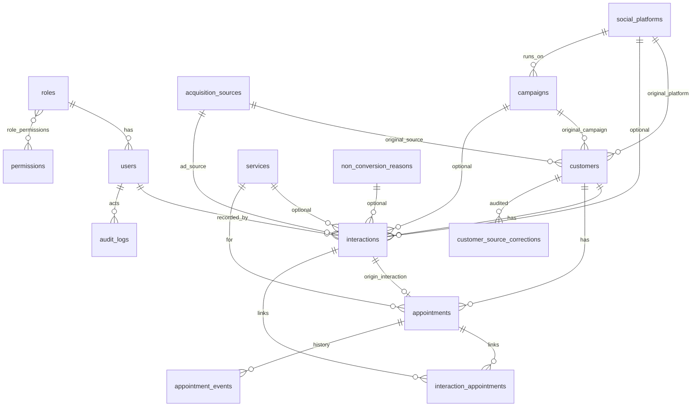

# Babi Dental Analytics: Phase 1 Architecture

## 1. Architecture
Front controller (`public/index.php`) → Router → Middleware (session, CSRF, auth, permission) → Controller → Service → Model (PDO, prepared statements) → View (escaped output).
Only `public/` is web-visible; `app/`, `config/`, `storage/`, `.env` sit above the web root.

| Layer | Responsibility |
|---|---|
| Middleware | `AuthMiddleware`, `PermissionMiddleware`, `CsrfMiddleware`, `RateLimitMiddleware` |
| Services | `InteractionService` (one shared pipeline for all channels), `QuestionnaireService` (field/branch rules per channel + reason), `CustomerService` (search, duplicate check), `AttributionService`, `AppointmentService`, `AuditService` |
| Analytics | `Analytics\*` query classes; every metric is SQL over stored records |
| Reports | CSV (formula-injection safe) and PDF writers |

**Channel binding:** the channel is derived from the logged-in role (receptionist→`reception`, call_operator→`phone`, social_tracker→`social_dm`), never from form input. A DB trigger also makes `interactions.channel` immutable.

## 2. ER diagram

## 3. How the core entities relate
- **customers**: one row per person. Holds the *original acquisition* (source, platform, campaign, channel, date). Write-once; changes only through `customer_source_corrections` (reason + user) with a DB trigger enforcing it.
- **interactions**: one row per contact, many per customer. Holds the *subsequent* platform/source/campaign, the channel, reason, and outcome. A "new customer" interaction is `is_first_contact=1`; follow-ups and campaign responses are never acquisitions.
- **appointments**: belong to a customer. `origin_interaction_id` (unique) marks the single interaction that created it, so a booking is counted once. Later interactions attach through `interaction_appointments` (`followup`, `fulfilled`, `reference`).
- **appointment_events** (extra table): status history (requested→confirmed→completed/cancelled/no_show), so the funnel is traceable without double counting.
- **Outcomes kept distinct:** inquiry = an interaction row; requested/confirmed booking = `booking_outcome` + appointment status; completed appointment = appointment status; service usage = reception `service_usage_outcome='used'`. DB CHECKs stop reception rows carrying booking data and phone/DM rows carrying usage data.
- **Campaign attribution** is only the `campaign_id` staff selected; never inferred from dates.

## 4. Role-permission matrix (enforced server-side)
| Capability | Admin | Reception | Call op | Social | Marketing |
|---|:-:|:-:|:-:|:-:|:-:|
| Admin dashboard / settings / users / audit logs | ✔ | | | | |
| Own-channel entry dashboard + questionnaire | ✔* | ✔ | ✔ | ✔ | |
| Search / register customers | ✔ | ✔ | ✔ | ✔ | |
| See customer name & phone | ✔ | ✔ | ✔ | ✔ | ✘ |
| Edit/archive customers, correct original source | ✔ | | | | |
| View own recent interactions (24h edit window) | ✔ | ✔ | ✔ | ✔ | |
| View all interactions | ✔ | | | | |
| Manage sources, platforms, campaigns, services | ✔ | | | | |
| Manage appointments | ✔ | ✔ | ✔ | ✔ | |
| Marketing dashboard, aggregate analytics | ✔ | | | | ✔ |
| Data-quality review | ✔ | | | | |
| Export aggregate reports | ✔ | | | | ✔ |
| Export identifiable records | ✔ (logged) | | | | |

*Admin can use any entry form only through an explicit channel-choice screen; recorded as that channel. Channel-specific forms for each entry role only see their own channel's records.

## 5. Analytics definitions (summary)
- **New customers** = `COUNT(customers)` with `first_acquisition_at` in range, `status<>'merged'`.
- **Interactions** = rows in `interactions`; **unique customers** = `COUNT(DISTINCT customer_id)`.
- **Bookings** = `COUNT(appointments)` where `origin_interaction_id IS NOT NULL` (created in range). Inquiries are not bookings.
- **Booking conversion** = bookings ÷ phone+DM interactions with `booking_outcome <> 'not_applicable'`, per channel. **Usage rate** = `used` ÷ (`used`+`not_used`) for reception only. Never mixed.
- **Acquisition share** = new customers per original source ÷ all new customers; "Unknown" is shown as its own slice, never redistributed.
- **Campaign table** shows three separate columns: associated interactions, new customers attributed (`original_campaign_id`), existing customers responding (`campaign_response` interactions from non-first-contact customers).
- No impressions, reach, or ROI figures; the data does not exist.

## 6. Assumptions (all configurable)
1. Phone numbers are normalised to digits for duplicate checks; duplicates warn but are not hard-blocked (families share phones).
2. A customer needs a name **or** phone; both are optional individually.
3. One role = one channel for entry users. A staff member covering two channels needs two accounts (keeps audit and reports clean).
4. Entry users may edit only their own interactions for 24 hours; later changes are admin-only and audited. Original acquisition is never editable by them.
5. Service list is a placeholder to replace in Settings; reasons and sources are also editable.
6. Timezone default Africa/Addis_Ababa; timestamps stored as local clinic time.
7. Merged-customer support is schema-ready (`merged_into_customer_id`); merge UI comes with Phase 3.

## 7. Build status
- Phase 1 schema, triggers, seed data: **done and tested** (MariaDB 10.11.14: FKs, CHECKs, write-once and immutability triggers, permission seed counts).
- Phases 2 to 10: **not started**.
